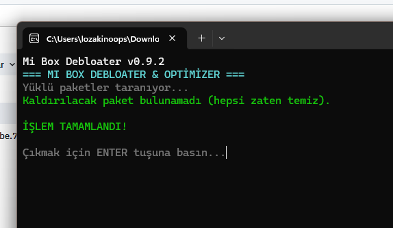

<div align="center">

# 📺 Mi Box Debloater

**One-click debloater & optimizer for Xiaomi Mi Box / Android TV. No ADB install needed.**

[](https://github.com/bxiefr/Mi-Box-Debloater/releases/latest)
[](https://github.com/bxiefr/Mi-Box-Debloater/releases)
[](https://github.com/bxiefr/Mi-Box-Debloater/stargazers)
[](https://github.com/bxiefr/Mi-Box-Debloater/network/members)

[](https://github.com/bxiefr/Mi-Box-Debloater/actions/workflows/build.yml)
[](LICENSE)
[](https://www.python.org/)
[](https://github.com/bxiefr/Mi-Box-Debloater/releases/latest)
[](https://www.android.com/tv/)
[](README.tr.md)
[](https://github.com/bxiefr/Mi-Box-Debloater/issues)
[](https://github.com/bxiefr/Mi-Box-Debloater/commits/main)
[](#-contributing)

**English** · [Türkçe](README.tr.md)

[⬇️ **Download**](https://github.com/OWNER/REPO/releases/latest) · [🐛 Report a bug](https://github.com/OWNER/REPO/issues) · [💡 Request a feature](https://github.com/bxiefr/Mi-Box-Debloater/issues)



</div>

---

## 🤔 Why?

Mi Box ships with apps you never asked for: Mi TV+, Mi Music, analytics services, preinstalled streaming apps and more. They eat RAM and storage and make the interface sluggish. This tool removes them safely over the network, in a minute, with a backup you can restore any time.

## ✨ Features

- 🧹 **One-click cleanup** of Xiaomi, Google and streaming bloatware
- 💾 **Automatic backup & restore**: undo everything with a single menu choice
- 🛡️ **Protected packages**: launcher, settings, Play Services, Chromecast, voice search, keyboard and system components can never be removed
- 🔍 **Dry-run mode**: see exactly what would be removed before anything changes
- ✅ **Confirmation step** with a risk label (safe / caution) for every package
- ⚡ **Faster UI**: animation speed tuning, optional dexopt
- 📦 **Package list export**: dump the packages on your device to a file
- 📡 **ADB included**: the Windows build ships with platform-tools, nothing to install or add to PATH
- 🌍 **Turkish & English** interface
- 🎨 **Colorful terminal UI** with live progress

## 🚀 Quick start

1. **Enable debugging on your Mi Box**
   Settings → Device Preferences → About → tap *Build* 7 times, then Settings → Device Preferences → Developer options → turn on **USB debugging / Network debugging**.
2. **Find the Mi Box IP address**
   Settings → Network & Internet → your Wi-Fi/Ethernet connection.
3. **Download** `Mi-Box-Debloater-vX.Y.Z.exe` from the [latest release](https://github.com/OWNER/REPO/releases/latest) and run it on a PC in the same network.
4. Pick your language, enter the IP, and choose **1) Debloat and optimize**.
5. The first time, accept the debugging prompt on your TV ("Always allow").

## ⌨️ Command line

The exe is a console app. Run it from a terminal to use options:

```
Mi-Box-Debloater-v1.0.0.exe --ip 192.168.1.45 --lang en --dry-run
```

| Option | Description |
| --- | --- |
| `--ip IP[:port]` | Mi Box address (default port 5555) |
| `--lang tr\|en` | Interface language |
| `--dry-run` | Show what would be removed, change nothing |
| `--restore` | Restore packages from the latest backup |
| `--backup-file FILE` | Use a specific backup file for `--restore` |
| `--export-packages` | Save the device package list to a text file |
| `--safe-only` | Only remove packages labeled *safe* |
| `--no-optimize` | Skip animation tuning and dexopt |
| `--dexopt` | Run dexopt without asking (takes 10-30 minutes) |
| `--anim-scale N` | Animation scale, default `0.5` |
| `--no-reboot` | Do not reboot when finished |
| `-y`, `--yes` | No prompts (for scripts) |
| `--version` | Print the version |

## 🧹 What gets removed

| Category | Package | What it is |
| --- | --- | --- |
| Xiaomi | `com.mitv.tvhome.mitvplus` | Mi TV+ |
| Xiaomi | `com.xiaomi.mimusic2` | Mi Music |
| Xiaomi | `com.mitv.videoplayer` | Mi video player |
| Xiaomi | `com.mitv.gallery` | Gallery |
| Xiaomi | `com.xiaomi.mitv.mediaexplorer` | Media explorer |
| Xiaomi | `com.xiaomo.tv.milegal` | Legal documents app |
| Xiaomi | `com.mitv.tvhome.michannel` | Mi channel |
| Xiaomi | `com.xiaomi.mibox.gamecenter` | Game center |
| Xiaomi | `com.xiaomi.tv.recommend` | Recommendation service |
| Analytics | `com.miui.tv.analytics`, `com.xiaomi.statistic` | Analytics / statistics services |
| Google | `com.google.android.feedback` | Feedback service |
| Google | `com.google.android.partnersetup` | Partner setup |
| Google | `com.google.android.syncadapters.calendar`, `...contacts` | Calendar / contacts sync |
| Google | `com.google.android.videos`, `...music`, `...play.games` | Play Movies, Play Music, Play Games |
| Google | `com.google.android.youtube.tvmusic` | YouTube Music TV |
| Streaming | `com.amazon.amazonvideo.livingroom` | Prime Video |
| Streaming | `com.disney.disneyplus` | Disney+ |
| Streaming | `com.apple.atve.androidtv.appletv` | Apple TV |
| Android | `com.android.htmlviewer`, `com.android.printspooler` | HTML viewer, print service |

Only packages actually installed on your device are listed and removed. **If you use one of these apps (for example Disney+), remove it from the list before running.**

## 🛡️ Safety

- Packages are removed with `pm uninstall -k --user 0`: they are removed **for the current user only**. The system partition is untouched and a factory reset brings everything back.
- Before removing anything, a JSON backup is saved next to the exe. Choose **2) Restore** to bring packages back.
- Critical packages (launcher, settings, Google Play Services, Chromecast, voice search, keyboard, WebView, Amlogic system packages and more) are protected and skipped even if they end up in the list.
- Use `--dry-run` first if you are unsure.

> **Disclaimer:** This tool is provided as is, without warranty. You use it at your own risk. It is not affiliated with Xiaomi or Google.

## ❓ FAQ

**Do I need to install ADB?**
No. The Windows exe includes Android platform-tools. When running `main.py` directly, ADB must be in your PATH.

**Windows SmartScreen / Defender shows a warning.**
The exe is built with PyInstaller and is not code-signed, which often triggers a warning. It is built by the public [GitHub Actions workflow](.github/workflows/build.yml) from the source in this repository, and you can build it yourself.

**It cannot connect to my Mi Box.**
Make sure the PC and the Mi Box are on the same network, Network debugging is on, and you accepted the prompt on the TV. The real ADB error is printed on screen and saved to `mibox_debloater.log`.

**Does it work on other Android TV devices?**
It is built for the Mi Box series. Other Android TV devices may work, but package names differ. Use **3) Export package list**, review it, and always try `--dry-run` first.

**Why is dexopt optional?**
It compiles every app on the device and can take 10-30 minutes on a Mi Box. Most of the speed-up comes from removing bloat and tuning animations.

**Linux / macOS?**
Run `python main.py` with Python 3.10+ and ADB installed. Prebuilt binaries are Windows only.

## 🏗️ Build from source

```
python main.py
```

Release builds are produced by GitHub Actions. Push a tag like `v1.0.0`, or run the **Build and Release Mi Box Debloater** workflow manually and enter the version. The version you enter is used in the exe title, `--version` output, logs, backups and the release name.

## 🤝 Contributing

Pull requests are welcome. To add packages, edit `PACKAGES` in `main.py` and include the output of **3) Export package list** from your device so the package can be verified. Packages that could break the system belong in `PROTECTED`.

## 📜 License & credits

Released under the [MIT License](LICENSE). Windows builds bundle Android SDK Platform-Tools by Google, which are subject to their own license terms.

---

<div align="center">

### ⭐ If this saved your Mi Box, please leave a star!

[](https://star-history.com/#OWNER/REPO&Date)

</div>
