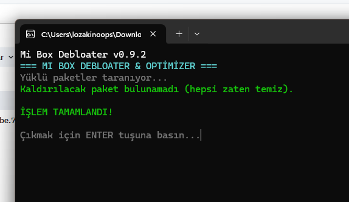

<div align="center">

# 📺 Mi Box Debloater

**Xiaomi Mi Box / Android TV için tek tıkla gereksiz uygulama temizleyici ve optimize edici. ADB kurmaya gerek yok.**

[](https://github.com/bxiefr/Mi-Box-Debloater/releases/latest)
[](https://github.com/bxiefr/Mi-Box-Debloater/releases)
[](https://github.com/bxiefr/Mi-Box-Debloater/stargazers)
[](https://github.com/bxiefr/Mi-Box-Debloater/network/members)

[](https://github.com/bxiefr/Mi-Box-Debloater/actions/workflows/build.yml)
[](LICENSE)
[](https://www.python.org/)
[](https://github.com/bxiefr/Mi-Box-Debloater/releases/latest)
[](https://www.android.com/tv/)
[](README.md)
[](https://github.com/bxiefr/Mi-Box-Debloater/issues)
[](https://github.com/bxiefr/Mi-Box-Debloater/commits/main)
[](#-katkıda-bulunma)

[English](README.md) · **Türkçe**

[⬇️ **İndir**](https://github.com/bxiefr/Mi-Box-Debloater/releases/latest) · [🐛 Hata bildir](https://github.com/bxiefr/Mi-Box-Debloater/issues) · [💡 Özellik iste](https://github.com/bxiefr/Mi-Box-Debloater/issues)



</div>

---

## 🤔 Neden?

Mi Box, hiç istemediğin uygulamalarla geliyor: Mi TV+, Mi Music, analitik servisleri, önceden yüklü yayın uygulamaları ve fazlası. Bunlar RAM ve depolamayı yiyor, arayüzü yavaşlatıyor. Bu araç, hepsini ağ üzerinden güvenli şekilde, bir dakikada kaldırır ve istediğin an geri yükleyebileceğin bir yedek alır.

## ✨ Özellikler

- 🧹 Xiaomi, Google ve yayın uygulaması gereksizlerini **tek tıkla temizler**
- 💾 **Otomatik yedek ve geri yükleme**: tek menü seçimiyle her şeyi geri al
- 🛡️ **Korumalı paketler**: launcher, ayarlar, Play Hizmetleri, Chromecast, sesli arama, klavye ve sistem bileşenleri asla silinmez
- 🔍 **Deneme modu (dry-run)**: bir şey değişmeden önce neyin silineceğini gör
- ✅ Her paket için etiket, onay adımı ve **kullanıyor olabileceğin uygulamalar için ayrı sorular** (Netflix, Prime Video, Disney+ ve diğer yayın uygulamaları)
- ⚡ **Daha hızlı arayüz**: animasyon ayarı, isteğe bağlı dexopt
- 📦 **Paket listesi aktarma**: cihazındaki paketleri dosyaya kaydet
- 📡 **ADB dahil**: Windows sürümü platform-tools ile gelir, kurulum veya PATH ayarı gerekmez
- 🌍 **Türkçe ve İngilizce** arayüz
- 🎨 Canlı ilerleme gösteren **renkli terminal arayüzü**

## 🚀 Hızlı başlangıç

1. **Mi Box'ta hata ayıklamayı aç**
   Ayarlar → Cihaz Tercihleri → Hakkında → *Derleme* üzerine 7 kez bas, sonra Ayarlar → Cihaz Tercihleri → Geliştirici seçenekleri → **USB hata ayıklama / Ağ hata ayıklama** seçeneğini aç.
2. **Mi Box'ın IP adresini bul**
   Ayarlar → Ağ ve İnternet → bağlı olduğun Wi-Fi/Ethernet bağlantısı.
3. [Son sürümden](https://github.com/bxiefr/Mi-Box-Debloater/releases/latest) `Mi-Box-Debloater-vX.Y.Z.exe` dosyasını indir ve aynı ağdaki bir bilgisayarda çalıştır.
4. Dilini seç, IP'yi gir ve **1) Temizle ve optimize et** seçeneğini seç.
5. İlk seferde TV ekranındaki hata ayıklama iznini onayla ("Her zaman izin ver").

## ⌨️ Komut satırı

Exe bir konsol uygulaması. Seçenekleri kullanmak için terminalden çalıştır:

```
Mi-Box-Debloater-v1.0.0.exe --ip 192.168.1.45 --lang tr --dry-run
```

| Seçenek | Açıklama |
| --- | --- |
| `--ip IP[:port]` | Mi Box adresi (varsayılan port 5555) |
| `--lang tr\|en` | Arayüz dili |
| `--dry-run` | Neyin silineceğini göster, hiçbir şeyi değiştirme |
| `--restore` | Son yedekten paketleri geri yükle |
| `--backup-file DOSYA` | `--restore` için belirli bir yedek dosyası kullan |
| `--export-packages` | Cihazdaki paket listesini metin dosyasına kaydet |
| `--safe-only` | Sadece *güvenli* etiketli paketleri kaldır (isteğe bağlı yayın uygulamalarını atlar) |
| `--include-optional` | İsteğe bağlı yayın uygulamalarını sormadan kaldır |
| `--no-optimize` | Animasyon ayarını ve dexopt'u atla |
| `--dexopt` | Sormadan dexopt çalıştır (10-30 dakika sürer) |
| `--anim-scale N` | Animasyon ölçeği, varsayılan `0.5` |
| `--no-reboot` | Bitince yeniden başlatma |
| `-y`, `--yes` | Soru sorma (betikler için) |
| `--version` | Sürümü yazdır |

## 🧹 Neler kaldırılıyor

| Kategori | Paket | Ne olduğu |
| --- | --- | --- |
| Xiaomi | `com.mitv.tvhome.mitvplus` | Mi TV+ |
| Xiaomi | `com.xiaomi.mimusic2` | Mi Music |
| Xiaomi | `com.mitv.videoplayer` | Mi video oynatıcı |
| Xiaomi | `com.mitv.gallery` | Galeri |
| Xiaomi | `com.xiaomi.mitv.mediaexplorer` | Medya gezgini |
| Xiaomi | `com.xiaomo.tv.milegal` | Yasal metin uygulaması |
| Xiaomi | `com.mitv.tvhome.michannel` | Mi kanal |
| Xiaomi | `com.xiaomi.mibox.gamecenter` | Oyun merkezi |
| Xiaomi | `com.xiaomi.tv.recommend` | Öneri servisi |
| Analitik | `com.miui.tv.analytics`, `com.xiaomi.statistic` | Analitik / istatistik servisleri |
| Google | `com.google.android.feedback` | Geri bildirim servisi |
| Google | `com.google.android.partnersetup` | Partner kurulumu |
| Google | `com.google.android.syncadapters.calendar`, `...contacts` | Takvim / kişi senkronu |
| Google | `com.google.android.videos`, `...music`, `...play.games` | Play Filmler, Play Müzik, Play Oyunlar |
| Google | `com.google.android.youtube.tvmusic` | YouTube Music TV |
| Yayın | `com.amazon.amazonvideo.livingroom` | Prime Video (önce sorulur) |
| Yayın | `com.disney.disneyplus` | Disney+ (önce sorulur) |
| Yayın | `com.apple.atve.androidtv.appletv` | Apple TV (önce sorulur) |
| Yayın | `com.netflix.ninja` | Netflix (önce sorulur) |
| Yayın | `com.exxen.android` | Exxen (önce sorulur) |
| Yayın | `com.iqiyi.i18n.tv` | iQIYI (önce sorulur) |
| Yayın | `com.turkcell.ott` | Turkcell TV+ (önce sorulur) |
| Yayın | `com.digiturk.iq.mobil` | Digiturk İQ (önce sorulur) |
| Android | `com.android.htmlviewer`, `com.android.printspooler` | HTML görüntüleyici, yazdırma servisi |

Sadece cihazında gerçekten yüklü olan paketler listelenir ve kaldırılır.

**Yayın uygulamaları isteğe bağlıdır.** Herkes Netflix'i ya da Disney+'ı bloat olarak görmez, bu yüzden araç her biri için ayrıca sorar ve sadece ENTER'a basarsan uygulama kalır. `-y` ile çalıştırırsan, `--include-optional` da vermedikçe bunlar atlanır.

## 🛡️ Güvenlik

- Paketler `pm uninstall -k --user 0` ile kaldırılır: yani **sadece mevcut kullanıcı için**. Sistem bölümüne dokunulmaz, fabrika ayarlarına dönmek sistem uygulamalarını geri getirir. Sonradan kendin yüklediğin uygulamalar (örneğin Exxen ya da iQIYI) geri yüklemeden sonra Play Store'dan tekrar kurulmak zorunda kalabilir, araç bunları kaldırmadan önce seni uyarır.
- Bir şey kaldırılmadan önce exe'nin yanına JSON yedeği kaydedilir. Paketleri geri getirmek için **2) Geri yükle** seçeneğini kullan.
- Kritik paketler (launcher, ayarlar, Google Play Hizmetleri, Chromecast, sesli arama, klavye, WebView, Amlogic sistem paketleri ve daha fazlası) korumalıdır, listeye yanlışlıkla girse bile atlanır.
- Emin değilsen önce `--dry-run` kullan.

> **Sorumluluk reddi:** Bu araç olduğu gibi, garanti verilmeden sunulur. Kullanım riski sana aittir. Xiaomi veya Google ile bağlantısı yoktur.

## ❓ Sıkça sorulanlar

**ADB kurmam gerekiyor mu?**
Hayır. Windows exe'si Android platform-tools ile birlikte gelir. `main.py`'yi doğrudan çalıştırıyorsan ADB'nin PATH'te olması gerekir.

**Windows SmartScreen / Defender uyarı veriyor.**
Exe PyInstaller ile derleniyor ve kod imzalı değil, bu yüzden sık sık uyarı çıkar. Exe, bu repodaki kaynaktan herkese açık [GitHub Actions workflow'u](.github/workflows/build.yml) ile derlenir, istersen kendin de derleyebilirsin.

**Mi Box'a bağlanamıyorum.**
Bilgisayarın ve Mi Box'ın aynı ağda olduğundan, Ağ hata ayıklamanın açık olduğundan ve TV'deki izni onayladığından emin ol. ADB'nin gerçek hata mesajı ekrana yazılır ve `mibox_debloater.log` dosyasına kaydedilir.

**Diğer Android TV cihazlarında çalışır mı?**
Mi Box serisi için hazırlandı. Diğer Android TV cihazlarında çalışabilir ama paket adları farklıdır. **3) Paket listesini dosyaya aktar** ile listeyi inceleyip önce her zaman `--dry-run` dene.

**Dexopt neden isteğe bağlı?**
Cihazdaki tüm uygulamaları derler ve Mi Box'ta 10-30 dakika sürebilir. Hızlanmanın çoğu gereksizleri silmekten ve animasyon ayarından gelir.

**Linux / macOS?**
Python 3.10+ ve ADB kurulu olarak `python main.py` çalıştır. Hazır derlemeler sadece Windows içindir.

## 🏗️ Kaynaktan derleme

```
python main.py
```

Sürüm derlemeleri GitHub Actions ile üretilir. `v1.0.0` gibi bir tag gönder ya da **Build and Release Mi Box Debloater** workflow'unu elle çalıştırıp sürümü gir. Girdiğin sürüm exe başlığında, `--version` çıktısında, log'larda, yedeklerde ve release adında kullanılır.

## 🤝 Katkıda bulunma

Pull request'ler açıktır. Paket eklemek için `main.py` içindeki `PACKAGES` listesini düzenle ve paketin doğrulanabilmesi için cihazından **3) Paket listesini dosyaya aktar** çıktısını ekle. Sistemi bozabilecek paketler `PROTECTED` listesine girer.

## 📜 Lisans ve teşekkürler

[MIT Lisansı](LICENSE) ile yayınlanmıştır. Windows sürümleri, kendi lisans koşullarına tabi olan Google'ın Android SDK Platform-Tools paketini içerir.

---

<div align="center">

### ⭐ Mi Box'ını kurtardıysa, bir yıldız bırakmayı unutma!

[](https://star-history.com/#bxiefr/Mi-Box-Debloater&Date)

</div>
